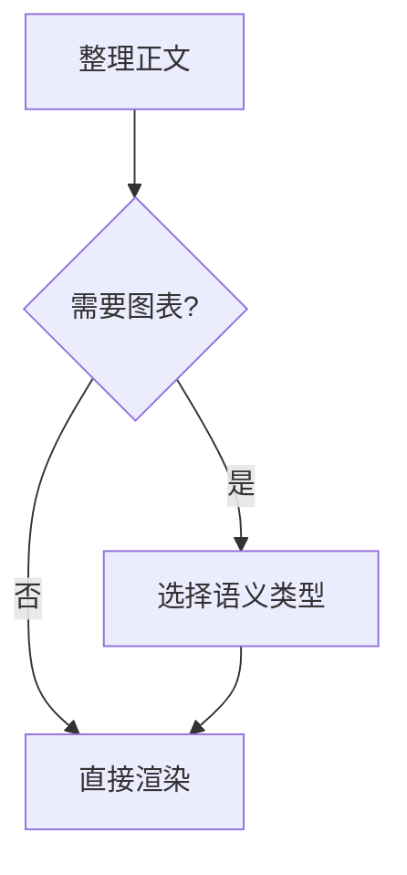
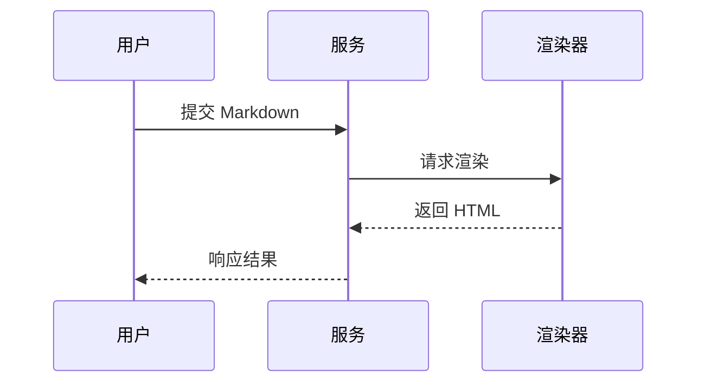
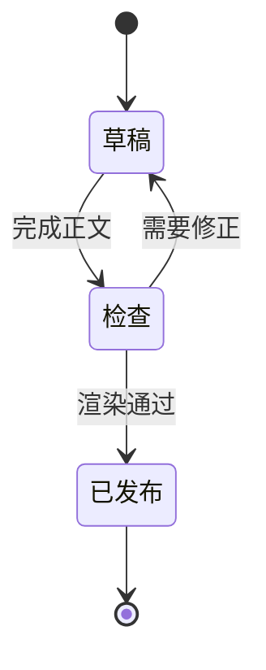
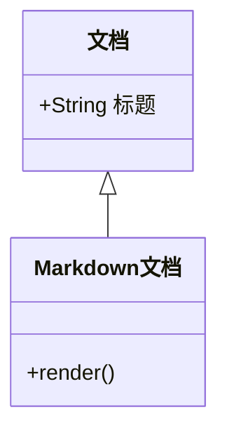
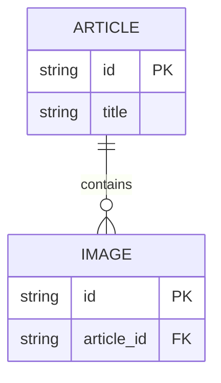
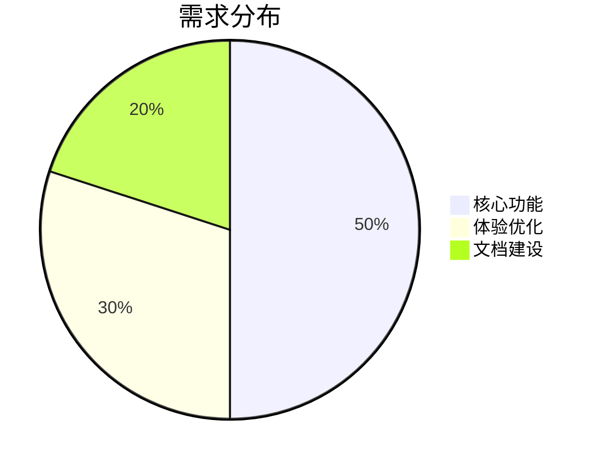
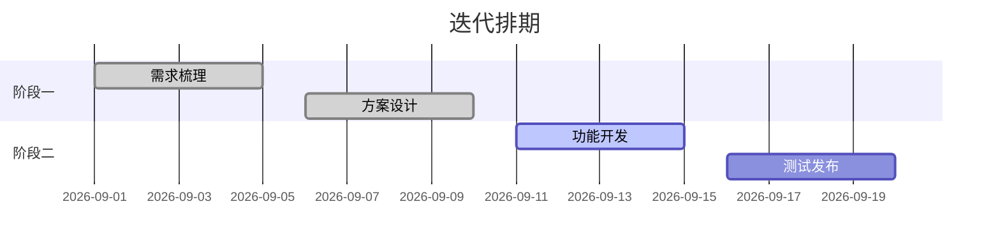
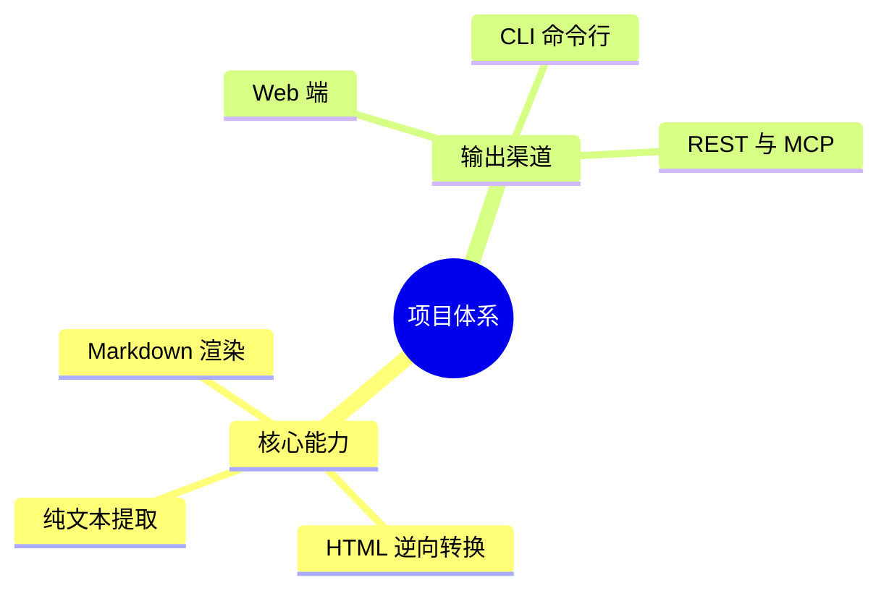
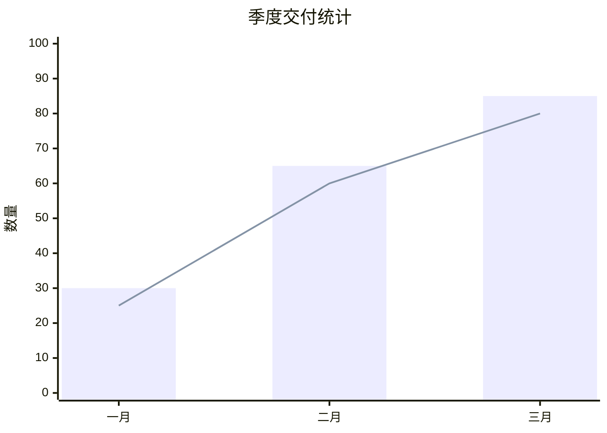

# Mermaid 图表

只在图形比正文更容易理解时使用 Mermaid。将合法语法放入语言为 `mermaid` 的围栏代码块，完成 Markdown 后交给 bm.md `render`。

bm.md 采用 [Pele](https://pele.run)（精确版本 1.6.0，[GitHub 源码](https://github.com/obsidianmd/pele/tree/1.6.0)）将纯文本 Mermaid 渲染为矢量 SVG。公共 API 与渲染实现在 Web Worker、Cloudflare Workers 与 Node.js 之间保持一致，无需 DOM 或 native Canvas 依赖。

## 选择图表

系统支持官方 33 种图表语法，并对 SVG 执行安全清洗与样式固化；不同类型的语法兼容性和布局能力以 Pele 1.6.0 为准。常见类型如下：

| 信息结构               | 图表类型          | 适用内容                     |
| ---------------------- | ----------------- | ---------------------------- |
| 流程、分支、调用链概览 | `flowchart`       | 操作流程、决策路径、依赖方向 |
| 按时间发生的交互       | `sequenceDiagram` | 服务调用、角色协作、请求响应 |
| 状态与状态迁移         | `stateDiagram-v2` | 生命周期、工作流状态         |
| 类、继承与成员         | `classDiagram`    | 领域模型、代码结构           |
| 实体、字段与基数       | `erDiagram`       | 数据模型、表关系             |
| 数据占比与分布         | `pie`             | 结构占比、份额分配           |
| 阶段与时间线推进       | `gantt`           | 项目排期、任务进度           |
| 发散思考与知识结构     | `mindmap`         | 概念层级、主题展开           |
| 趋势、对比与离散指标   | `xychart-beta`    | 折线与柱状统计、量化指标     |

## 稳定示例

### 流程图

### 时序图

### 状态图

### 类图

### ER 图

### 饼图

### 甘特图

### 思维导图

### XY 图表

xychart 的分类轴中文需显式使用引号包裹，如 `["一月", "二月", "三月"]`。

## 主题与样式配置

- **主题 ID**：仅支持留空 `""`（默认浅色）与 `"dark"`（深色）。
- **配置方式**：
  - CLI：通过 `--mermaid-theme dark` 切换深色主题。
  - API / 参数：在 `render` 请求中传入 `mermaidTheme: "dark"`（留空使用默认浅色）。
- **样式固化**：SVG 字体族和颜色在渲染时固化，深色主题自带显式深色背景。

## 运行约束与环境差异

- **跨环境显示**：不同运行时的文字测量方式与可用字体可能不同，图表尺寸可能略有差异。
- **安全边界**：默认禁止图表内部的外链跳转与外部图片引用。
- **规格限制**：
  - 单图输入上限：不超过 50,000 字符。
  - 单图输出上限：渲染后 SVG 不得超过 4,000,000 字符。
  - 连线上限：流程图最多支持 5,000 条边。

## 可读性规则

- 一个图只表达一个主题，节点标签使用正文语言。
- 保持方向一致；流程较长时优先 `TD`，调用链较短时可用 `LR`。
- 节点使用短语，把解释留在图外正文中。
- 分支边写清条件；时序消息使用动作短语；ER 实体补齐实际字段，避免空实体。
- 只表达已知关系，不补造节点、调用、字段或基数。
- 主题仅使用有效的主题 ID（空或 `dark`），不自行杜撰主题名称。

## 渲染失败处理

1. 检查围栏语言是否为 `mermaid`、首行图表类型拼写是否正确、括号与引号是否闭合（如 xychart 分类轴中文须加双引号）。
2. 确认输入是否超出 50,000 字符或 5,000 条连线上限。
3. 缩短标签并删除未经验证的复杂样式指令，先渲染最小图，再逐步恢复节点和关系。
4. 检查输出是否提示图表错误或超过 4,000,000 字符。
5. 仍失败时改用编号列表、Markdown 表格或普通代码块表达对应信息，保留全部事实，不交付错误图。
